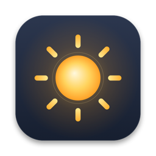

<div align="center">



# XDR Bright

**Free, lightweight macOS menu bar utility to unlock HDR brightness on built-in Liquid Retina XDR displays.**  
**免费开源的 macOS 菜单栏小工具：一键解锁 MacBook Pro 内置 Liquid Retina XDR 屏幕的高亮区间。**


[](https://github.com/wyiky/xdr-bright/releases/latest)

</div>

---

## Why XDR Bright? / 为什么做它？

By default, macOS limits SDR desktop content on MacBook Pro XDR displays to ~500–600 nits even though the panel can sustain 1000 nits full-screen (1600 nits peak). Paid apps like Vivid or DisplayBuddy unlock this, while **XDR Bright** gives you a clean, zero-dependency, MIT-licensed menu bar tool (~50 KB binary) with no subscriptions or background bloat.

默认情况下，MacBook Pro 的 XDR 屏幕在普通桌面场景只给到约 500–600 nits，而面板实际支持全屏持续 1000 nits（局部峰值 1600 nits）。**XDR Bright** 让你在户外或强光下不装付费软件、不占后台资源，点一下菜单栏太阳图标即可释放额外亮度。

---

## Features / 核心特性

- **Two Practical Presets / 实用两档增亮**：
  - **Tier 1 (`30%`)**：日常适度增亮（gamma `1.16×`，线性光强约 `1.39×`），观感自然。
  - **Tier 2 (`50%`)**：全屏封顶档（gamma `1.27×`，线性光强约 `1.69×`），在 100% 系统亮度下刚好吃满 XDR 全屏持续 1000 nits 上限，避免无意义地拉高灰阶导致画面泛白。
- **Native Brightness Keys Stay Working / 保留原生亮度键**：不接管背光控制，键盘亮度键依旧丝滑调节。
- **Drift Self-Healing / 漂移自愈**：每 2 秒自动核对一次 gamma 传输表末项，切分辨率、插拔显示器或睡眠唤醒后自动重施。
- **Fail-Safe Auto Restore / 退出自动还原**：gamma 表绑定在当前进程上，退出或异常崩溃时系统会自动恢复正常亮度。
- **Launch at Login / 登录自启**：通过 `~/Library/LaunchAgents` 实现开机自启，无需 Apple 开发者公证即可使用。

---

## Download & Install / 下载安装

1. 前往 [**Releases**](https://github.com/wyiky/xdr-bright/releases/latest) 下载最新的 `XDR-Bright.zip`。
2. 解压后将 `XDR Bright.app` 拖入「应用程序」(`/Applications`)。
3. 因为应用使用本地临时签名（未经 Apple 公证），首次打开时若被系统拦截：
   - **方法 A**：在「应用程序」里**右键点击 `XDR Bright.app` → 打开**；或
   - **方法 B**：在终端执行一次：
     ```bash
     xattr -d com.apple.quarantine "/Applications/XDR Bright.app"
     ```
4. 打开后点击菜单栏太阳图标，选择 **开启 HDR 增亮**，或直接点 **一档（30%）** / **二档（50%）**。

> **Tip / 提示**：如果菜单栏图标过多，macOS 可能会把新图标收进右侧 `«` 溢出区；另外请勿同时开启多个基于 gamma 表的 XDR 增亮工具，它们会互相覆盖。

---

## How It Works / 技术原理

Unlocking real HDR brightness above the SDR cap requires two pieces working together:

1. **256-sample Gamma Transfer Table (`CGSetDisplayTransferByTable`)**  
   Reads the display's baseline transfer table, scales it by `1 + 0.00535 × level`, and writes it back with **exactly 256 samples**. Passing `1024` samples causes macOS to clamp values `> 1.0` back to `1.0`, making brightness boosting fail silently.
2. **1×1 EDR Headroom Window (`EDRHeadroomWindow`)**  
   Keeps an invisible, click-through `1×1` floating layer (`extendedLinearDisplayP3`) with `wantsExtendedDynamicRangeContent = true`, signaling WindowServer to enter EDR output mode so gamma values `> 1.0` turn into real backlight gain rather than clipped highlights.

> Note: On macOS 26+, `CALayer.preferredDynamicRange = .high` alone does not raise `maximumExtendedDynamicRangeColorComponentValue`, whereas `wantsExtendedDynamicRangeContent = true` reliably unlocks EDR headroom.

---

## Build from Source / 从源码编译

Requires macOS 14+ and Swift toolchain (Xcode Command Line Tools is enough, full Xcode not required):

```bash
git clone https://github.com/wyiky/xdr-bright.git
cd xdr-bright/XDRBright

# 编译打包到 dist/XDR Bright.app 与 dist/XDR-Bright.zip
./script/build_app.sh

# 直接安装到 /Applications 并启动
./script/build_app.sh install
```

Self-test / 命令行自检：

```bash
swift run --package-path XDRBright XDRBright --selftest
```

---

## Project Structure / 项目结构

```text
xdr-bright/
├── HDRBrightness/          # Pure CoreGraphics + EDR headroom Swift Package (zero UI dependency)
│   └── Sources/HDRBrightness/
│       ├── HDRBrightness.swift
│       └── EDRHeadroomWindow.swift
├── XDRBright/              # Lightweight LSUIElement menu bar app
│   ├── Resources/AppIcon.icns
│   ├── Sources/XDRBright/
│   └── script/build_app.sh
└── assets/icon.png
```

`HDRBrightness` can also be imported directly as a local Swift Package in your own macOS app:

```swift
import HDRBrightness

let controller = HDRBrightnessController()
controller.apply(level: 50)
controller.restore()
```

---

## License & Acknowledgments / 许可与致谢

Released under the [MIT License](LICENSE).  
Implementation written from scratch; inspired by open-source projects [BrightIntosh](https://github.com/niklasr22/BrightIntosh) (GPL-3.0) and [BrightXDR](https://github.com/starkdmi/BrightXDR) (GPL-3.0) without copying code.
